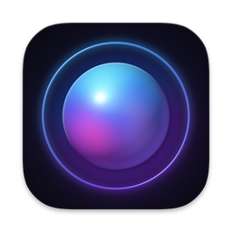
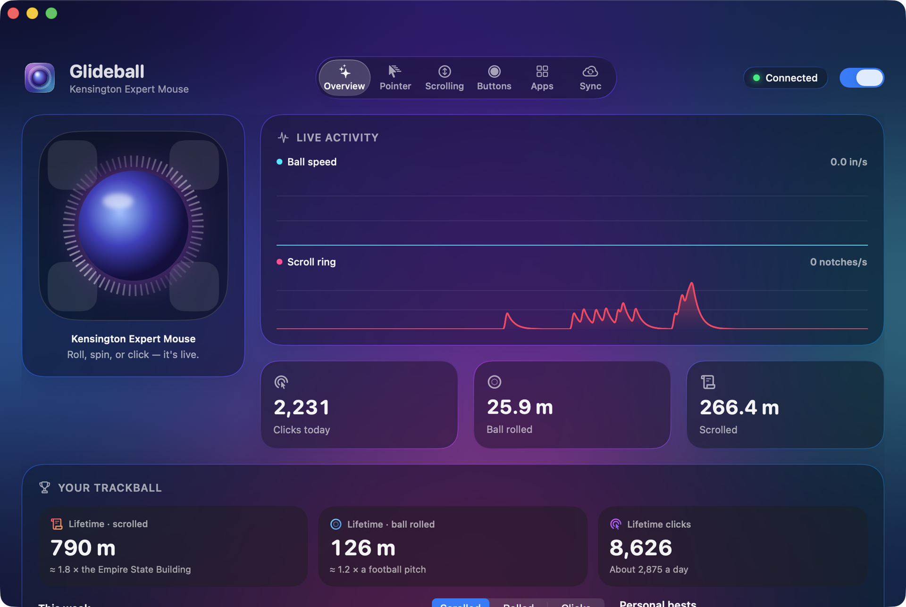
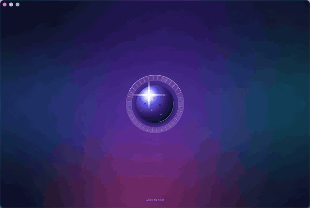
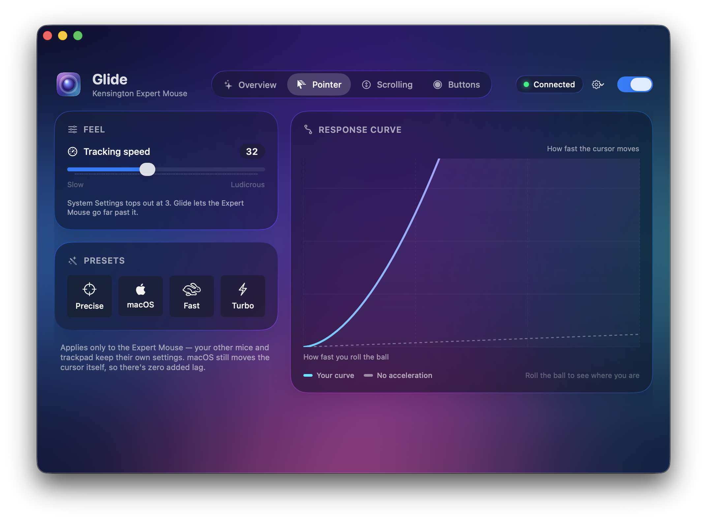
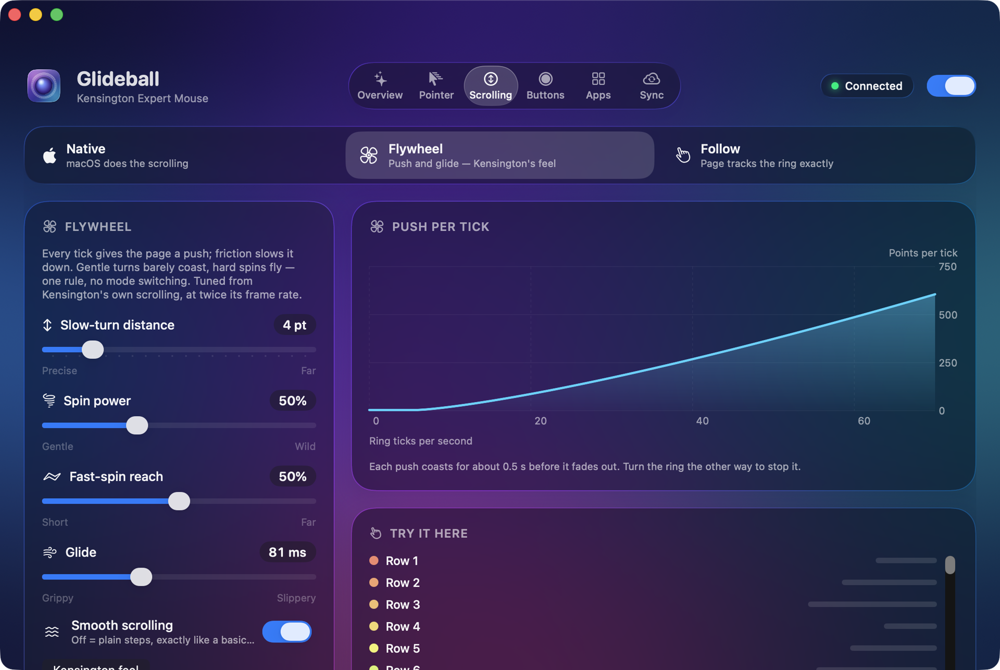
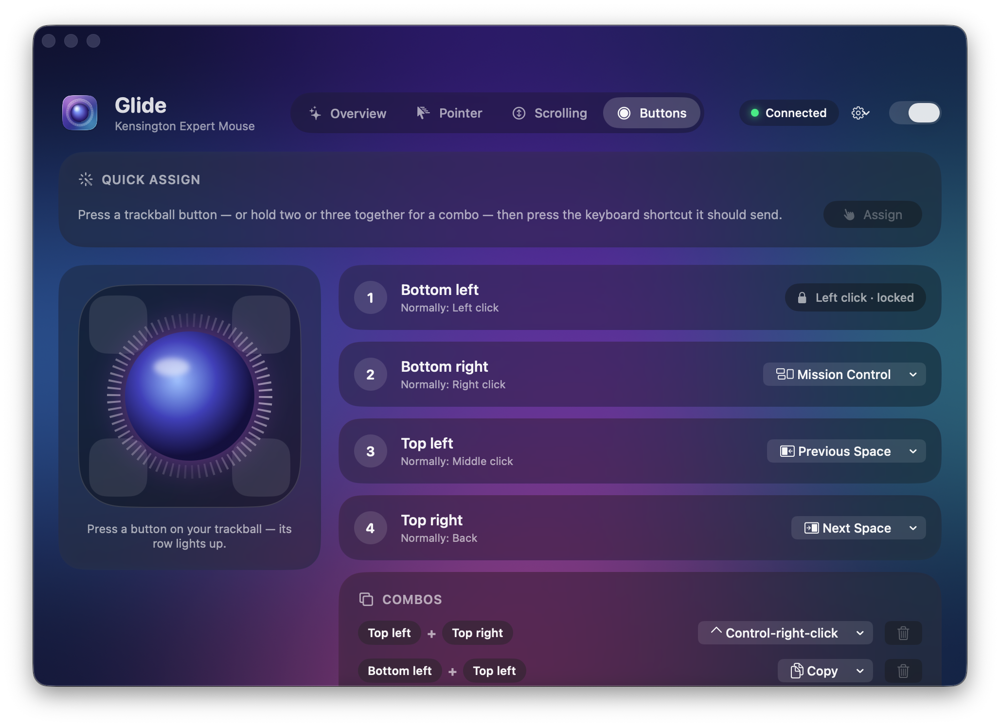

<p align="center">
  
</p>

<h1 align="center">Glideball</h1>

<p align="center">
  <b>A Mac app that makes Kensington trackballs feel right: a faster pointer, a better scroll ring, and buttons that do what you want.</b><br>
  Free and open source. A small, fast replacement for KensingtonWorks.
</p>

<p align="center">
  <a href="https://github.com/leviholliday/glideball/releases/latest/download/Glideball.zip"><b>Download for Mac</b></a>
  &nbsp;·&nbsp; <a href="#install">How to install</a>
  &nbsp;·&nbsp; <a href="https://glideball.netlify.app">Website</a>
  &nbsp;·&nbsp; <a href="https://glideball.netlify.app/feedback/">Feedback</a>
  <br>
  <sub>macOS 26 Tahoe or later · Apple silicon &amp; Intel · <a href="#linux--windows-preview">Linux &amp; Windows preview</a></sub>
</p>

I'm Levi, a student, and Glideball is my one-person project (not my only one). I built it after I got a Kensington trackball, installed Kensington's app and driver, and found it barely did anything I wanted and was hard to find my way around. With it you can push the pointer past the speed limit in System Settings, pick how the scroll ring should feel, and turn the buttons into clicks, shortcuts or multi-button combos. Your trackpad and other mice keep their own settings, and if you pause or quit Glideball, the trackball is an ordinary mouse again.

<p align="center">
  
</p>

## What you need

- A Mac with **macOS 26 Tahoe or later**, Apple silicon or Intel.
- A **Kensington trackball**:
  - **Expert Mouse (wired, USB):** fully supported. This is the one Glideball is built and tested on.
  - **Other Kensington trackballs** (SlimBlade, Orbit and others): Glideball shows them as **Beta only**. Click **Turn On Beta**, or turn on **Overview › General › Beta program**, to try yours. The wireless Expert Mouse may show up either way, depending on the name it reports.
- KensingtonWorks **uninstalled** (see [Install](#install)). Your trackpad and other mice are never touched.

The current release is **2.9.1**. A **2.10 beta** is out for people in the Beta program; where things differ, this page says so.

## Features

- **Pointer speed past macOS's limit.** System Settings stops at 3; Glideball goes much further, with presets and a live response curve. It only changes the trackball.
- **Three scroll feels:**

  | Mode | What it does |
  | --- | --- |
  | **Flywheel** *(default)* | Each tick pushes the page and friction slows it down, modeled on measurements of Kensington's own driver. A **Kensington feel** button restores those values. |
  | **Follow** | The page tracks the ring exactly and stops when you stop. A real flick can coast if you want. |
  | **Native** | macOS scrolls the ring itself, with a faster wheel speed for the trackball alone. |

- **Buttons, combos and shortcuts.** Set each button to a click, Back/Forward, Control- or Command-click, Mission Control, Spaces, Spotlight, copy/paste, any keyboard shortcut and more. Hold two or three buttons together for a combo, or use **Quick assign**: press the buttons, then the shortcut. The bottom-left button always stays a left click.
- **Precision, Scroll with ball and Drag lock.** Put them on a button or a keyboard shortcut: slow the cursor down for fine work, scroll by rolling the ball, or hold the left button down without holding it yourself.
- **Per-app setups.** On the Apps tab, any app can have its own pointer speed, scrolling and buttons, used while that app is in front.
- **It can't lock you out.** Press **Control-Option-Command-G** (⌃⌥⌘G) anywhere to pause or resume Glideball. It needs no permissions, so it works even if a mapping makes the trackball hard to use.
- **A live dashboard.** The Overview tab shows your trackball with buttons that light up as you press them, live speed graphs and today's clicks and distances.
- **Backup and sync.** File › Export Settings… (⌘E) and Import Settings… (⌘O), with a preview before anything changes. Optional sync through your own iCloud Drive, and automatic daily backups (a couple of KB each) you can restore with one click on the Sync tab.
- **Nine languages:** English, Español, Français, Deutsch, Italiano, Português (Brasil), 日本語, 한국어 and 简体中文.

Also: a menu bar icon, a welcome tour (Help › Show Welcome Tour…), and badges and personal bests (confetti and sounds can be turned off).

**What's out of the box?** In 2.9.1, the top-left button switches to the previous Space and the top-right to the next one, and pressing bottom-left plus both top buttons holds ⌃Space for dictation apps like Wispr Flow. Set any button back to **Default** on the Buttons tab, or delete the combo. In the **2.10 beta**, new installs start with normal buttons instead, and that setup is a one-click **Spaces + Wispr Flow** preset on the Buttons tab.

<details>
<summary><b>More screenshots</b></summary>
<br>
<p align="center">
  
  
  
  
</p>
</details>

## Is it safe?

- **Free and MIT-licensed.** All the code is here, so anyone can read it or build it.
- **A regular app.** No driver and no system extension. Glideball never takes the trackball away from macOS; it adjusts it from the side. Pause or quit it and the trackball works like any mouse.
- **It doesn't see what you type.** It only watches mouse buttons, scrolling and modifier keys (⇧⌃⌥⌘).
- **Updates are checked.** An update installs only if it's signed with the same certificate as the app you already have.

### Privacy

- **The app has no analytics, telemetry or tracking.** The website is separate: it uses cookie-free Cloudflare analytics, and Google Analytics only if you accept.
- Glideball goes online only to check GitHub for a newer version (at launch, then once a day), to download an update when you choose Install, to sync through your own iCloud Drive if you turn that on, and to send feedback when you press Send (you can review it first).
- Feedback is stored privately on Glideball's website (hosted by Netlify), and only I can read it. My phone gets a notification showing its subject line.
- iCloud sync is off until you turn it on. Your settings then go to **your own** iCloud Drive; sync never goes through a Glideball server.
- Activity totals stay on your Mac. Your settings and the scroll diagnostics log (scroll and button timings, no keystrokes) leave it only if you keep them attached to a feedback report; each has its own switch.

## Install

> [!IMPORTANT]
> **Have KensingtonWorks installed?** Uninstall it first, then restart your Mac. Its driver conflicts with Glideball.

1. **Download** [Glideball.zip](https://github.com/leviholliday/glideball/releases/latest/download/Glideball.zip), unzip it, and drag **Glideball** into **Applications**. (On the [Releases page](https://github.com/leviholliday/glideball/releases), pick `Glideball.zip`; `Glide.zip` is only for Glide 2.7.1 and older.)

   Prefer [Homebrew](https://brew.sh)? This replaces step 1; steps 2 and 3 still apply:
   ```sh
   brew install --cask leviholliday/tap/glideball
   ```
2. **Open it, then approve it once.** macOS will say Apple could not verify Glideball is free of malware. That's expected: Glideball is free and made by one developer without a paid Apple developer account, so Apple hasn't notarized it, and all of its code is public here. Click **Done** (not Move to Trash), open **System Settings › Privacy & Security**, scroll to the message about Glideball, click **Open Anyway** and enter your Mac password if asked. You only do this once; updates don't ask again.
3. **Grant two permissions.** Glideball's window has buttons for both:
   - **Accessibility** lets Glideball change button and scroll events.
   - **Input Monitoring** lets Glideball tell your trackball apart from your other devices and read the scroll ring.

   Until both are on, the trackball works normally and Glideball does nothing.

## Using Glideball

- **Closing the window keeps Glideball running.** Bring it back from the Dock or the menu bar icon › Show Glideball. Turn on **Open at login** in Overview › General to have it start quietly.
- **Updates:** when one is out, a button with the new version number appears at the top of the window. Choose **Install & Relaunch**; your permissions carry over. Want early builds? Turn on **Overview › General › Beta program**.
- **Quit** with ⌘Q or the menu bar icon › Quit Glideball. In 2.9.1, Quit in the Dock is ignored on purpose; the 2.10 beta makes it work.
- **New in the 2.10 beta:** an **ⓘ** button that opens About & Help (updates, feedback, the tour, links and an email row with your version info filled in); a **Show in Dock and app switcher** switch to run purely from the menu bar; a **Software Update** window for Check for Updates…; an Edit menu so copy and paste work in text fields; and pausing or quitting now puts the trackball back at its normal System Settings speed.
- **Why do some files say "Glide"?** That was the app's name until 2.8, and its settings and folders kept it.

**To uninstall:**

1. Turn off Open at login, then quit with ⌘Q or the menu bar icon › Quit Glideball.
2. Drag Glideball to the Trash.
3. In System Settings › Privacy & Security, remove it from Accessibility and Input Monitoring.
4. Optional, to remove your settings too: delete `~/Library/Application Support/Glide` and `~/Library/Logs/Glide` (Finder › Go › Go to Folder…), delete the iCloud Drive › Glide folder if you used sync, and run `defaults delete com.leviholliday.glide` in Terminal.

With Homebrew: quit first, then run `brew uninstall --zap --cask glideball`.

## FAQ and troubleshooting

- **"Apple could not verify Glideball." Is it safe?** Yes. It means I don't pay for Apple's notarization, not that anything is wrong. Follow [step 2](#install), and read [Is it safe?](#is-it-safe) if you'd like to know more.
- **Buttons do two things at once.** KensingtonWorks is probably still installed. Uninstall it and restart.
- **How do I get my normal trackball back right now?** Press ⌃⌥⌘G, or quit Glideball.
- **Permissions are on, but nothing changes.** Remove Glideball from both lists in Privacy & Security and add it again, or run `tccutil reset All com.leviholliday.glide` in Terminal. Then restart Glideball.
- **Where did the window go?** Click Glideball in the Dock or use the menu bar icon › Show Glideball.
- **Can it import my KensingtonWorks settings?** No, but Quick assign on the Buttons tab sets things up quickly.
- **Does it use much CPU or battery?** Very little. To use even less, set Overview › General › Performance to Efficient or Minimal.

## Linux & Windows (Preview)

> [!NOTE]
> **These are previews.** They share the Mac app's scroll physics, buttons, combos and `.glide-settings` files, and their automated tests pass, but they haven't been tested on real trackballs yet. Please [send feedback](https://glideball.netlify.app/feedback/).

| | Download | Details |
|---|---|---|
| **Linux** (Ubuntu 24.04+, Fedora 39+) | [.tar.gz](https://github.com/leviholliday/glideball/releases/latest/download/Glideball-Linux-Preview.tar.gz) · [.deb](https://github.com/leviholliday/glideball/releases/latest/download/Glideball-Linux-Preview.deb) | Tarball: unpack and run `./install.sh` (it asks for your password). .deb: `sudo apt install ./Glideball-Linux-Preview.deb`, then `systemctl --user enable --now glideball`. See [linux/README.md](linux/README.md). |
| **Windows** 10/11 | [Installer (x64)](https://github.com/leviholliday/glideball/releases/latest/download/Glideball-Windows-Preview-Setup-x64.exe) · [ARM](https://github.com/leviholliday/glideball/releases/latest/download/Glideball-Windows-Preview-Setup-arm64.exe) | Unsigned, so SmartScreen warns once (More info › Run anyway). See [windows/README.md](windows/README.md). |

Both act only on the Expert Mouse (other Kensington trackballs only with the Beta program switch); every other mouse, touchpad and trackball is left alone.

## Get help

- **In the app:** Help › Send Feedback…, the menu bar icon › Send Feedback…, or Overview › General › Send Feedback… (in the 2.10 beta, also the ⓘ button).
- **On the web:** the [feedback page](https://glideball.netlify.app/feedback/).
- **Email:** [glideball@proton.me](mailto:glideball@proton.me)
- **In public:** [GitHub issues](https://github.com/leviholliday/glideball/issues)

Glideball is made by one student developer. I read everything, but replies can take a few days.

## Contributing

Bug reports and ideas are very welcome. Translations go through [scripts/l10n/README.md](scripts/l10n/README.md). If you'd like to send code, please open an issue first so we can talk it over. Want to build Glideball or see how it works? See [docs/DEVELOPING.md](docs/DEVELOPING.md).

## Disclaimer

Glideball is an independent project. It is not affiliated with, endorsed by, or sponsored by Kensington. Kensington, Expert Mouse and KensingtonWorks are trademarks of their respective owners, and every other trademark belongs to its owner.

## License

[MIT](LICENSE) © 2026 Levi Holliday · [Gravatar](https://gravatar.com/optimistic1bba948d22)
